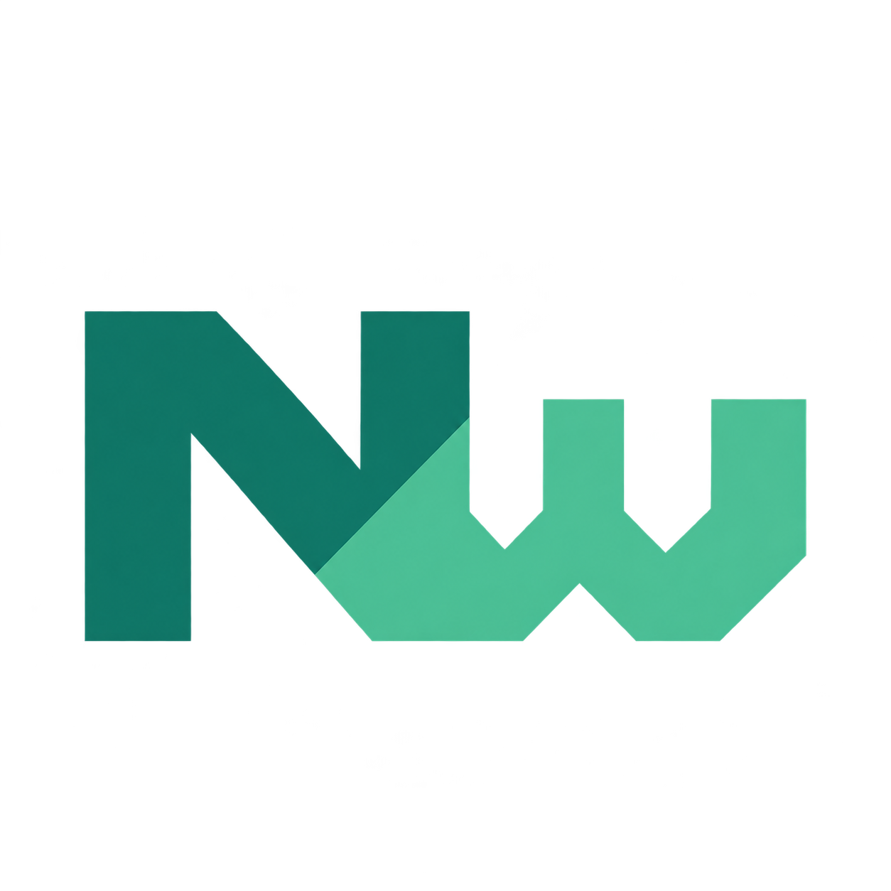

<h1 align="center">
  <br>
  Northwood
</h1>

Northwood is a fork of Stela that boots Apple silicon macOS on x86-64 PCs.
It combines a UEFI boot program, an arm64-to-x86-64 translator, a Metal driver
for NVIDIA GPUs and a model of Apple silicon hardware.

> [!WARNING]
Northwood is still in development. Check the [hardware notes](hardware/) for
device-specific support and verification status, including the
[Intel MacBook Pro inventory](hardware/macbook-pro-intel.md).

## Translator

Northwood keeps Stela's translated arm64 UEFI boot path. Its `northwood
import-oc` tool reads an existing configuration and exports reviewable
Northwood hints for that path.

An ahead-of-time and just-in-time compiler translates arm64e code to x86-64.
It covers more than 3,000 AArch64 instruction encodings, maps guest registers
to host registers and caches translated code. It runs on any x86-64-v2 CPU,
Intel or AMD.

## NVIDIA driver

The Metal driver supports GTX 16 and RTX 20 series GPUs and newer. It compiles
AIR, Metal's shader IR, directly to NIR, Mesa's IR, and supports the Metal3
and Apple7 GPU families.

## Requirements

- An x86-64-v2 CPU (about 2011 or newer), UEFI with Secure Boot off, 4 GB of
  RAM. 8 GB or more is recommended: with less than about 7 GB free, Stela
  boots in a compact profile that gives macOS 2 GB or a little more and runs
  slower.
- An NVIDIA GTX 16 or RTX 20 series GPU or newer.
- A USB stick of 8 GB or more for a network installer, or 32 GB or more
  for a full installer.
- An empty GPT partition of at least 60 GB.
- Network access to prepare the restore image and Apple's signing answers.
  A network installer also downloads macOS during installation.

Stela currently models the Mac mini (M2) and runs macOS 27.

## Install

1. Download the archive for your system from
   [Northwood releases](https://github.com/NiSeullent/Northwood/releases).
2. On the PC that will run macOS, run `sudo ./northwood setup` on Linux or
   macOS. On Windows, run `northwood.exe setup` or open `stela.exe` for the
   installer wizard. The `stela setup` command also works.
3. Choose the USB stick, the macOS version and the Mac model, then confirm.
   Setup erases the USB stick.
4. Boot the PC from the USB stick.

The removable-media entry is `EFI/BOOT/BOOTX64.EFI`. With the bundled
Northwood loader, a fresh setup writes `EFI/northwood/nwconfig.plist` and
keeps its data under `northwood/`. Setup labels a newly formatted data
partition `NORTHWOOD`. Updates and repairs preserve the recorded layout,
including `EFI/stela` and `stela/` on existing Stela media.

### Create an offline USB

Use `--installer offline` to put the complete macOS restore image on the
USB, or `--installer online` to download macOS during installation. The
wizard chooses a full installer for USB sticks of 32 GB or more. A full
installer can install without internet when it contains all of Apple's
signing answers.

To create the USB on a disconnected PC, use the same Northwood release
on both computers and first prepare a kit on a connected computer. Use
the complete IPSW for the supported Mac mini (M2) model.

```sh
./northwood setup prepare-offline --ipsw macOS.ipsw --output northwood-kit
```

The kit contains the signed restore bundle, its machine identity, and the
image verification data. Prepare a separate kit for each machine identity.
Northwood stages firmware for the supported NVIDIA GPUs it detects.
If the target PC has a different GPU, pass its chip name with
`--gpu CHIP` when preparing the kit. Copy the kit and the exact IPSW to the
disconnected computer. Keep both on a separate disk from the destination USB.

```sh
sudo ./northwood setup --usb /dev/sdX --ipsw macOS.ipsw --offline-kit northwood-kit
```

Replace `/dev/sdX` with the removable USB's whole-disk path. The command
asks before erasing it. Without an interactive terminal, pass
`--confirm-disk` with the USB's exact model or displayed size. On Windows,
use `northwood.exe` and the appropriate `PhysicalDriveN` device name.
If Wi-Fi or other target firmware must be supplied from a separate pinned
cache, pass `--host-firmware-cache DIRECTORY`.
If writing is interrupted after formatting, rerun with the same kit and
IPSW and pass the USB's mounted EFI or data volume as `--usb` to resume.

## Build

You need [Rust](https://rustup.rs) and LLVM with Clang 21 or newer.

```sh
git clone https://github.com/NiSeullent/Northwood
cd Northwood
cargo xtask dist
```

The build writes `target/release/northwood`, `target/release/stela` and a
matching `northwood.efi`. The first build fetches and compiles Linux, Mesa
and LLVM sources.

## Legal

Setup obtains macOS from Apple. You are responsible for following Apple's
software license agreement and terms of use.

The project source defaults to GPL-2.0-or-later. The UEFI program is
distributed under GPL-2.0-only and the CLI under GPL-3.0-or-later. See
[LICENSING.md](LICENSING.md), [LICENSE](LICENSE), [NOTICE](NOTICE) and
[CREDITS.md](CREDITS.md).

## Community

[Discord Server](https://discord.gg/aSkwrJEMYc)
